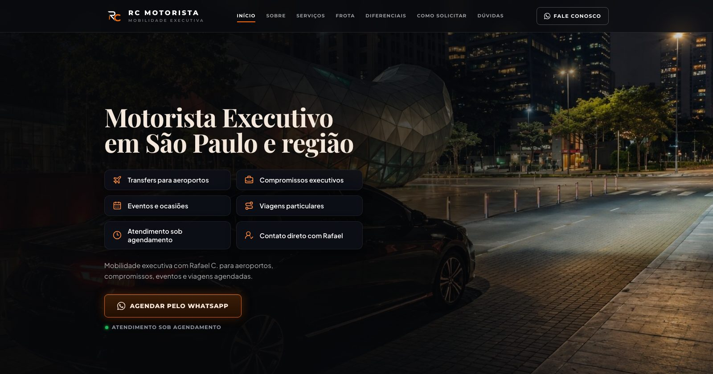

<div align="center">
<h1>RC Motorista</h1>
<p><strong>Landing page for a private and executive driver in São Paulo.</strong></p>
<p>A premium, dark interface built to convey trust, present services and vehicle options clearly, and drive the first contact through WhatsApp.</p>
<p><a href="https://landing-page-rc-motorista.vercel.app">View live site</a></p>
</div>

## Preview

<p align="center">
  
</p>

## Overview

RC Motorista offers private and executive transportation in São Paulo and the surrounding region. The page guides visitors from the value proposition to the main action: a WhatsApp conversation to check availability and book a ride. Every claim on the page comes from the real service (no invented metrics, reviews, or 24/7 promises).

The 2026 redesign moved the site to a premium executive transfer look: full-screen hero, glass navigation, card-based sections, a focus-effect fleet carousel, and subtle motion throughout.

## Sections

- **Hero:** full-screen photo with a slow zoom, service chips, and the WhatsApp call to action
- **About:** light section presenting the service and the driver
- **Services:** six cards (airport transfers, executive appointments, events, trips, recurring rides, personalized on-board service)
- **Mobility options:** fleet carousel (sedan, SUV, minivan, van) where the active vehicle is highlighted and each card opens WhatsApp with the chosen category pre-filled
- **Differentiators:** punctuality, discretion, direct contact, comfort, fast communication, safety
- **How to book:** three animated step cards
- **FAQ:** accessible accordion, one answer open at a time
- **Final call to action and footer:** WhatsApp, Instagram, phone, and service area

## Highlights

- **Fleet carousel without dependencies** (`src/hooks/useFleetCarousel.ts`): arrows with wrap-around, dots, click, keyboard arrows, and swipe on desktop; scroll-snap track on screens up to 991px, with the active dot following native scrolling.
- **Accessibility:** semantic landmarks, skip link, visible focus, scroll spy with `aria-current`, focus-managed mobile drawer (Esc closes), `aria-live` announcements in the carousel, and `prefers-reduced-motion` support.
- **Performance:** no UI libraries beyond React and lucide icons, compressed images, and only the font weights in use.
- **Editable content:** all copy, services, fleet data, and FAQ live in `src/data/site.ts`.

## Tech Stack

- Vite
- React 19
- TypeScript
- Tailwind CSS
- lucide-react
- Vitest and Testing Library

## Getting Started

```sh
npm install
npm run dev     # development server
npm run test    # unit and integration tests
npm run build   # type check and production build
```

## Project Structure

```txt
src/
  data/site.ts            # all editable content
  components/             # one component per section, plus shared pieces
  hooks/useFleetCarousel.ts
  styles/fleet.css        # fleet carousel styles
images/frota/             # fleet illustrations (see the README in that folder)
scripts/                  # image processing helper for the fleet illustrations
```

## Deploy

Live at https://landing-page-rc-motorista.vercel.app
Production branch: `main`

## Author

Built by **[Pedro Passos Corsini](https://github.com/pedropcorsini)** as a portfolio project and real product for the RC Motorista brand.
